# 🛡️ QRShield — Zero-Trust QR & URL Threat Intelligence Platform

<p align="center">
  
</p>

<p align="center">
  <strong>Next-Generation Defense-in-Depth Cybersecurity Protection against Quishing, Deceptive Phishing, and Drive-By Payloads.</strong>
</p>

<p align="center">
  <a href="#-technology-matrix"></a>
  <a href="#-technology-matrix"></a>
  <a href="#-technology-matrix"></a>
  <a href="#-technology-matrix"></a>
  <a href="#-technology-matrix"></a>
  <a href="#-technology-matrix"></a>
  <a href="#-technology-matrix"></a>
  <a href="#-technology-matrix"></a>
  <a href="#-automated-testing--verification"></a>
</p>

---

## 📌 Table of Contents

- [1. Executive Overview](#1-executive-overview)
- [2. System Architecture & Threat Flow](#2-system-architecture--threat-flow)
- [3. The 8-Domain Security Inspection Pipeline](#3-the-8-domain-security-inspection-pipeline)
- [4. Calibrated Scoring & Risk Engine](#4-calibrated-scoring--risk-engine)
- [5. Platform Components](#5-platform-components)
  - [5.1. Backend Service (`Main_Backend/backend`)](#51-backend-service-main_backendbackend)
  - [5.2. Mobile Client (`Frontend/`)](#52-mobile-client-frontend)
  - [5.3. Chrome Extension (`Extension/`)](#53-chrome-extension-extension)
- [6. Monorepo Repository Structure](#6-monorepo-repository-structure)
- [7. Complete REST API Specification](#7-complete-rest-api-specification)
- [8. Installation & Deployment Guide](#8-installation--deployment-guide)
  - [8.1. Running the Spring Boot Backend](#81-running-the-spring-boot-backend)
  - [8.2. Running the Mobile Application (Expo / React Native)](#82-running-the-mobile-application-expo--react-native)
  - [8.3. Installing the Chrome Extension (Manifest V3)](#83-installing-the-chrome-extension-manifest-v3)
- [9. Automated Testing & Verification](#9-automated-testing--verification)
- [10. Zero-Trust Security Guarantees](#10-zero-trust-security-guarantees)
- [11. Contributing & License](#11-contributing--license)

---

## 1. Executive Overview

**QRShield** is an enterprise-grade, zero-trust cybersecurity ecosystem designed to protect mobile and desktop users against deceptive QR codes (**Quishing**) and malicious web destinations before user devices are compromised.

Standard QR scanners naively open whatever link is encoded inside a QR matrix. Threat actors exploit this behavior using:
1. **Physical QR Sticker Tampering:** Overlaying malicious QR stickers onto parking meters, restaurant menus, payment terminals, and transit ticketing hubs.
2. **Obfuscated Multi-Hop Redirection:** Abusing URL shorteners (`bit.ly`, `tinyurl.com`, `t.co`) to evade basic link filters.
3. **Homoglyph & Brand Typosquatting:** Impersonating trusted banking, social media, and fintech portals (e.g., `paypa1-security.com`, `g00gle.com`).
4. **Algorithmic DGA & Ephemeral TLDs:** Registering high-entropy domains under untrusted Top-Level Domains (`.xyz`, `.top`, `.click`, `.buzz`, `.cam`).
5. **In-Flight Drive-By Payloads:** Triggering silent executable and APK file downloads without user consent.
6. **Credential Theft Forms:** Rendering phishing password input fields on external or unencrypted protocols.

QRShield intercepts and evaluates targets across a **defense-in-depth inspection pipeline**:

* **Pre-Click Heuristics (<50ms):** Validates SSRF guardrails, analyzes Shannon entropy, checks brand spoofing, and traces redirect hops.
* **Dynamic VM Browser Sandboxing:** Boots headless Chromium in an isolated VirtualBox Ubuntu linked clone to detect DOM password traps (`<input type="password">`) and form exfiltration.
* **Download-to-Hash Quarantine Vault:** Intercepts payload binaries, writes them to a sandboxed directory, computes SHA-256 digests, and queries the **VirusTotal v3 REST API** (powered by 70+ antimalware engines).
* **Explainable Risk Engine:** Aggregates findings into a synchronized **Safety Score (100–0)** and calibrated **Threat Risk Index (0–100)** with clear security recommendations.

---

## 2. System Architecture & Threat Flow

```mermaid
flowchart TD
    subgraph CLIENTS ["Clients & Ingestion Layers"]
        A1["📱 Mobile App (Camera / Gallery / URL)"]
        A2["🌐 Chrome Extension (Auto Tab Navigation)"]
    end

    subgraph PREFLIGHT ["Layer 1: Pre-Flight Network Shield"]
        B1["UrlSecurityValidator (SSRF Guard)"]
        B2{"Private IP / Loopback / Cloud IMDS?"}
        B3["⛔ Immediate Security Policy Abort (Score 100/100)"]
    end

    subgraph HEURISTICS ["Layer 2: Pre-Click Static Engine (<50ms)"]
        C1["UrlAnalysisService"]
        C2["Brand Impersonation & Typosquatting"]
        C3["Abused TLD & Shannon Entropy Profiling"]
        C4["Shortener Unwinding (bit.ly, t.co) & Redirection"]
        C5["TLS / Transport Layer Security Protocol Check"]
        C6["Hosting Provider & ASN Infrastructure Mapping"]
    end

    subgraph SANDBOX ["Layer 3: Dynamic Isolated VM Sandbox"]
        D1["VirtualBoxSandboxManager (Ubuntu Base Clone)"]
        D2["Headless Chromium Execution"]
        D3["DOM Password Credential Trap Inspection (<input type='password'>)"]
        D4["Form Action & Third-Party Exfiltration Tracing"]
        D5["Headless Browser Snapshot PNG Proof"]
        D6["Ephemeral VM Poweroff & Zero-Contagion Deletion"]
    end

    subgraph QUARANTINE ["Layer 4: Quarantine Vault & Threat Intelligence"]
        E1["DownloadCaptureService (Stream Interceptor)"]
        E2["Quarantine Storage Vault (./data/quarantine)"]
        E3["FileHashService (SHA-256 Digesting)"]
        E4["VirusTotal v3 API Client (70+ Antimalware Engines)"]
        E5["Zero-Trust Safety Invariant (NO_KNOWN_MATCH vs MALICIOUS)"]
    end

    subgraph SYNTHESIS ["Layer 5: Explainable Risk Engine & Telemetry"]
        F1["ExplainableRiskEngine"]
        F2["Calibrated Threat Risk (0–100) & Safety Rating (100–0)"]
        F3["Human-Readable Plain English Explanations"]
        F4["Actionable Security Guidance & Warnings"]
    end

    subgraph STORAGE ["Layer 6: Persistence & Dispatch"]
        G1[("MySQL 8 (Relational JPA)")]
        G2[("MongoDB Atlas (Telemetry Cache)")]
        G3["REST API Response (JSON Payload with Telemetry)"]
    end

    A1 -->|POST /api/scan/analyze| B1
    A2 -->|POST /api/scan/analyze| B1

    B1 --> B2
    B2 -- Yes --> B3
    B2 -- No (Valid) --> C1

    C1 --> C2 & C3 & C4 & C5 & C6
    C1 -->|Deep Scan Request| D1
    C1 -->|In-Flight Download| E1

    D1 --> D2 --> D3 & D4 & D5 --> D6
    E1 --> E2 --> E3 --> E4 --> E5

    C1 & D6 & E5 --> F1
    F1 --> F2 & F3 & F4
    F2 & F3 & F4 --> G1 & G2 --> G3
    G3 -->|Harmonized Result| A1 & A2
```



---

## 3. The 8-Domain Security Inspection Pipeline

Both the Mobile App and the Chrome Extension evaluate links against the 8 security domains defined in the backend architecture:

| Domain | Underlying Backend Component | Telemetry & Signals Checked | Evaluation Criteria & Guardrails |
| :--- | :--- | :--- | :--- |
| **1. Network & SSRF Shield** | `UrlSecurityValidator` | `dnsResolved`, `isIpHost`, `resolvedIp` | Rejects RFC 1918 private ranges (`10.0.0.0/8`, `172.16.0.0/12`, `192.168.0.0/16`), loopback (`127.0.0.1`), and Cloud IMDS metadata (`169.254.169.254`). |
| **2. Brand & Impersonation Engine** | `UrlAnalysisService` | `reputableDomain`, Levenshtein metrics | Identifies brand mimicry targeting PayPal, Google, Microsoft, Apple, Amazon, SBI, HDFC, Binance, Coinbase, etc. |
| **3. TLD & Entropy Profiling** | `UrlAnalysisService` | `domainEntropy`, `isSuspiciousTld`, `tld` | Penalizes high-risk TLDs (`.xyz`, `.top`, `.click`, `.buzz`, `.monster`, `.cam`, `.quest`). Flags domains with Shannon entropy $> 4.5$ as algorithmically generated (DGA). |
| **4. Redirection & Shorteners** | `UrlAnalysisService` | `isUrlShortener`, `hasRedirects`, `redirectChain` | Automatically unwinds URL shorteners (`bit.ly`, `tinyurl.com`, `t.co`, `is.gd`, `cutt.ly`) and traces destination hops. |
| **5. TLS / Protocol Security** | `UrlAnalysisService` & Dynamic VM | `https`, `protocol`, `usesHttps` | Validates active HTTPS encryption. Insecure plain HTTP links are strictly elevated to at least `SUSPICIOUS` (risk score $\ge 50$). |
| **6. Infrastructure & Hosting** | `UrlAnalysisService` | `providerName`, `ipAddress`, `canonicalHost` | Maps origin IP addresses, resolves PTR reverse DNS hosts, and identifies cloud providers (Google Cloud, AWS, Cloudflare, Azure, Vercel, etc.). |
| **7. Dynamic VM Browser Sandbox** | `VirtualBoxSandboxManager`, `GuestWorkerClient` | `findings` (`DOM_PASSWORD_TRAP`, form exfiltration) | Executes headless Chromium inside an isolated ephemeral Ubuntu clone to detect DOM credential traps (`<input type="password">`) and form stealing. |
| **8. Quarantine Vault & VirusTotal v3** | `VirusTotalHashProvider`, `DownloadCaptureService` | `downloadArtifacts`, `sha256`, `reputationStatus` | Intercepts unsolicited downloads, computes SHA-256 digests, and queries VirusTotal v3 across 70+ AV engines. Adheres to zero-trust invariant: clean hashes are marked `NO_KNOWN_MATCH`, never assumed safe. |

---

## 4. Calibrated Scoring & Risk Engine

QRShield provides an intuitive dual-metric scoring presentation across both mobile and desktop clients:

1. **Safety Score / Security Index (100–0):** Consumer-facing trust score. Higher is better ($100$ = Clean/Safe, $0$ = Dangerous).
2. **Threat Risk Index (0–100):** Threat-intelligence calibrated index. Lower is better ($0$ = Clean, $100$ = Critical Risk).

### Score Calibration Matrix

| Threat Risk Score | Safety Score | Grade | Verdict | Real-World Destination Profile | Actionable Advice |
| :---: | :---: | :---: | :---: | :--- | :--- |
| **`0 – 29`** | **`100 – 71`** | **`A`** | `SAFE` | Verified brand domain, standard TLS, direct destination, 0 threat signals. | Safe to open. Standard vigilance recommended. |
| **`30 – 49`** | **`70 – 51`** | **`B`** | `LOW RISK` | Benign canonical redirect, low-entropy domain, valid certificate. | Safe to open. Confirm destination in address bar. |
| **`50 – 69`** | **`50 – 31`** | **`C`** | `SUSPICIOUS` | Unencrypted HTTP, suspicious TLD (`.xyz`), shortened link, or password field without verified brand. | Exercise caution. Do not enter credentials or passwords. |
| **`70 – 100`** | **`30 – 0`** | **`F`** | `DANGEROUS` | Confirmed malware signature (VirusTotal hit), brand spoofing, SSRF violation, or form exfiltration. | **Do NOT open.** High probability of credential theft or infection. |

---

## 5. Platform Components

### 5.1. Backend Service (`Main_Backend/backend`)
* **Technology:** Java 21 LTS, Spring Boot 4.1.2 / 3.4.2, Spring Data JPA (Hibernate 6), MySQL 8, MongoDB Atlas, Oracle VirtualBox 7+, Google ZXing 3.5.3.
* **Core Responsibilities:**
  * Coordinates URL lexical analysis, TLD checks, and brand spoofing heuristics in under 50ms.
  * Manages ephemeral Ubuntu VM lifecycles via `VBoxManage` CLI, provisioning linked clones from `clean-worker-ready` snapshots and terminating them after execution.
  * Enforces DoS guardrails on file downloads (25 MB max per file, 3 downloads per scan, 500 MB aggregate LRU quarantine).
  * Queries VirusTotal v3 with live API key and offline air-gapped mock fallbacks (EICAR, WannaCry, Emotet, Locky).
  * Stores scan records, user profiles, community blocked domains, threat reports, and mobile device notification tokens.

### 5.2. Mobile Client (`Frontend/`)
* **Technology:** React Native 0.88, Expo SDK 58, TypeScript (Strict Mode), React Navigation 7, React Native SVG.
* **Core Responsibilities:**
  * Real-time camera QR scanning with hardware-accelerated target bounding boxes (`expo-camera`).
  * Photo gallery QR image import (`expo-image-picker`) with server-side ZXing extraction.
  * Manual URL Inspector for pre-click verification of links copied from SMS, WhatsApp, or emails.
  * Animated **Radar Shield** visualization during analysis.
  * **Semicircular Security Gauge** and dual-metric scoring panel on the Result and Analysis Details screens.
  * Dedicated **Domain & Network Intelligence Telemetry Card** displaying Shannon entropy, canonical host, TLD standing, and DNS resolved IP.
  * Interactive **Analytics Dashboard** featuring risk breakdown donut charts, trendlines, and scan volume statistics.
  * Searchable Scan History with category filtering and deletion.
  * Crowdsourced Threat Reporting and Custom Blocked Domains management.
  * User Authentication (JWT-based Sign In, Sign Up, Profile, Google Login flow).
  * Dark / Light mode theme switcher and internationalization support.

### 5.3. Chrome Extension (`Extension/`)
* **Technology:** Manifest V3, React 18, Vite, TypeScript (Strict Mode), Shadow DOM.
* **Core Responsibilities:**
  * **Automated Tab Scanning:** Background service worker listens to `chrome.webNavigation.onCompleted` and `chrome.tabs.onUpdated` to analyze websites automatically.
  * **In-Page Floating Security Banner:** Content script injects a lightweight, isolated Shadow DOM banner on visited web pages. Green badge auto-minimizes after 7 seconds to a discreet floating shield; amber/red alerts remain visible with full threat indicators. Zero host page style contamination.
  * **Dynamic Chrome Toolbar Badging:** Toolbar icon updates in real-time (`✓` green, `!` amber, `✕` red, `...` analyzing) per tab.
  * **Instant Popup View:** Opening the extension popup displays the pre-analyzed result immediately with zero loading lag.
  * **Fail-Secure Architecture:** Unencrypted `http://` sites and warning signs are automatically elevated to `SUSPICIOUS` (score $\ge 50$). Network failures default to `UNKNOWN` or `ERROR` and are never displayed as safe.
  * **Strict Content Security Policy (CSP):** Operates under `"script-src 'self'; object-src 'self';"`. Strictly zero dynamic `eval` or remote script loading.

---

## 6. Monorepo Repository Structure

```
QRShield/
├── .gitignore                                 # Root Git ignore configuration
├── README.md                                  # Comprehensive architecture & setup documentation
│
├── Main_Backend/                              # Backend Threat Engine & Orchestration
│   └── backend/
│       ├── pom.xml                            # Maven dependencies (Java 21, Spring Boot, MySQL, MongoDB, ZXing)
│       ├── mvnw / mvnw.cmd                    # Maven wrapper binaries
│       ├── application.properties             # Master configuration (Ports, DB, VirtualBox, VirusTotal)
│       ├── .env                               # Environment overrides (MySQL password, VT API Key)
│       ├── src/
│       │   ├── main/java/com/qrshield/backend/
│       │   │   ├── QrshieldBackendApplication.java # Spring Boot main entrypoint
│       │   │   ├── auth/                      # JWT auth, user entities, login/registration controllers
│       │   │   ├── blocklist/                 # Community & user-defined blocked domain controllers
│       │   │   ├── config/                    # CORS configuration, HTTP logging filter
│       │   │   ├── controller/                # UrlScanController, HealthController, DeepScanController
│       │   │   ├── dto/                       # ScanRequest, ScanResponse, DashboardStats DTOs
│       │   │   ├── entity/                    # ScanRecord, RiskCategory, ScanStatus JPA entities
│       │   │   ├── malware/                   # Download-to-hash quarantine vault & VirusTotal v3 provider
│       │   │   ├── notification/              # Device push notification tokens & security advisories
│       │   │   ├── reporting/                 # Crowdsourced malicious threat reports
│       │   │   ├── repository/                # Spring Data JPA & MongoDB repositories
│       │   │   ├── sandbox/                   # VirtualBox linked clone VM orchestration & CLI wrapper
│       │   │   ├── security/                  # UrlSecurityValidator (SSRF, RFC 1918, Cloud IMDS guard)
│       │   │   └── service/                   # ExplainableRiskEngine, UrlAnalysisService, QrCodeDecodeService
│       │   └── test/java/com/qrshield/backend/# JUnit 5 test battery & VirusTotal test runner
│
├── Frontend/                                  # Cross-Platform Mobile Client (React Native / Expo)
│   ├── package.json                           # React Native 0.88, Expo 58, React 19 dependencies
│   ├── tsconfig.json                          # TypeScript configuration
│   ├── app.json                               # Expo project manifest & permissions declaration
│   ├── src/
│   │   ├── components/                        # SecurityGauge, RadarShield, ScanResultSheet, RiskBadge, RiskScore
│   │   ├── constants/                         # Theme definitions, colors, typography, spacing
│   │   ├── context/                           # AuthContext, ThemeContext, LanguageContext
│   │   ├── navigation/                        # AppNavigator (Tabs + Native Stack Navigation)
│   │   ├── screens/                           # HomeScreen, ScannerScreen, UrlCheckerScreen, ResultScreen,
│   │   │                                      # AnalysisDetailsScreen, DashboardScreen, HistoryScreen, Auth
│   │   ├── services/                          # analysisService, apiConfig, historyService, blockedDomainsService
│   │   ├── types/                             # ScanAnalysis, ScanDetails, SecurityCheck, RiskLevel
│   │   └── utils/                             # URL validation, payload parsing, scheme sanitizers
│
└── Extension/                                 # Google Chrome Extension (Manifest V3)
    ├── package.json                           # React 18, Vite, Vitest, TypeScript dependencies
    ├── manifest.json                          # Chrome Extension Manifest V3 declaration
    ├── vite.config.ts                         # Vite Rollup multi-entry bundle configuration
    ├── vitest.config.ts                       # Vitest unit test configuration
    ├── public/                                # Extension icons (16, 32, 48, 128)
    └── src/
        ├── background/
        │   └── service-worker.ts              # Tab navigation watcher, badge color updates, request caching
        ├── content/
        │   └── content-script.ts              # In-page Shadow DOM floating security pill & details modal
        ├── popup/                             # React popup application (App.tsx, AnalysisResult.tsx)
        ├── services/                          # api.ts, responseValidation.ts, urlValidation.ts, storage.ts
        ├── types/                             # UrlAnalysisResponse, ScanDetails, SecurityCheck, Verdict
        └── test/                              # Vitest unit tests (33 tests covering API, contracts, validation)
```

---

## 7. Complete REST API Specification

The Spring Boot backend exposes a unified REST API across `http://<backend-host>:8080`:

### 7.1. URL & QR Scanning Endpoints

| Endpoint | Method | Payload / Parameters | Description |
| :--- | :---: | :--- | :--- |
| `/api/scan/analyze` | `POST` | `{"url": "https://...", "source": "MANUAL_URL", "notes": "..."}` | Core pre-click heuristic analysis, SSRF check, brand spoofing, and calibrated scoring. |
| `/api/scan/qr-image` | `POST` | `multipart/form-data` (`file`, `notes`) | Decodes uploaded QR image via ZXing and executes heuristic analysis. |
| `/api/scan/deep-analysis` | `POST` | `{"url": "https://...", "notes": "..."}` | Enqueues dynamic isolated VM browser sandbox inspection; returns `scanId`. |
| `/api/scan/{scanId}/status`| `GET` | `PathVariable scanId` | Polls dynamic VM execution progress, screenshot, and sandbox findings. |
| `/api/scan/{id}` | `GET` | `PathVariable id` | Retrieves complete historical scan record by UUID. |
| `/api/scan/history` | `GET` | `page=0, size=20, category=HIGH, search=paypal` | Retrieves paginated scan history with filtering and full text search. |
| `/api/scan/stats` | `GET` | None | Returns aggregated dashboard statistics (total scans, safe count, average risk score). |
| `/api/scan/history/{id}` | `DELETE`| `PathVariable id` | Deletes scan record from database. |

### 7.2. Sample Analysis JSON Response (`POST /api/scan/analyze`)

```json
{
  "id": "e884cf7c-f50e-495f-a08b-32f07e83d40e",
  "originalUrl": "https://google.com",
  "finalDestinationUrl": "https://www.google.com/",
  "domain": "google.com",
  "status": "SAFE",
  "riskCategory": "LOW",
  "riskScore": 0,
  "protocol": "HTTPS",
  "https": true,
  "providerName": "Google LLC / Alphabet Inc.",
  "ipAddress": "142.250.77.110",
  "hasRedirects": true,
  "redirectCount": 1,
  "redirectChain": [
    "https://google.com",
    "https://www.google.com/"
  ],
  "downloadDetected": false,
  "downloadArtifacts": [],
  "warningSigns": [
    "No significant cybersecurity threats or deceptive patterns detected."
  ],
  "securityRecommendations": [
    "URL appears safe based on domain reputation and heuristic indicators.",
    "Always maintain standard vigilance and verify the SSL padlock icon in your browser."
  ],
  "details": {
    "canonicalHost": "pnmaaa-aq-in-f14.1e100.net",
    "domainEntropy": 2.65,
    "dnsResolved": true,
    "resolvedIp": "142.250.77.110",
    "isSuspiciousTld": false,
    "tld": "com",
    "isUrlShortener": false,
    "reputableDomain": true,
    "isIpHost": false,
    "subdomainCount": 0
  },
  "scannedAt": "2026-10-24T04:34:04.1394343"
}
```

### 7.3. User Authentication, Blocklists & Reporting

| Endpoint | Method | Payload / Headers | Description |
| :--- | :---: | :--- | :--- |
| `/api/auth/register` | `POST` | `{"username": "...", "email": "...", "password": "..."}` | Creates new user account with BCrypt password hashing. |
| `/api/auth/login` | `POST` | `{"username": "...", "password": "..."}` | Authenticates credentials and returns JWT Bearer token. |
| `/api/user/profile` | `GET` | `Authorization: Bearer <token>` | Retrieves authenticated user profile. |
| `/api/user/blocked-domains`| `GET` / `POST` | `{"domain": "evil.xyz", "reason": "Phishing"}` | Manages custom personal domain blocklist. |
| `/api/scan/report` | `POST` | `{"targetUrl": "...", "reportType": "PHISHING", "comments": "..."}` | Submits community threat report for triage. |
| `/api/notifications/register-token` | `POST` | `{"deviceToken": "...", "platform": "ANDROID"}` | Registers mobile device push notification token. |
| `/api/health` | `GET` | None | System operational health, DB status, and engine version. |

---

## 8. Installation & Deployment Guide

### Prerequisites
* **Java:** JDK 21 LTS installed (`java -version`)
* **Node.js:** v18.0.0 or higher (`node -v`)
* **Package Manager:** `npm` (v9+) or `pnpm`
* **MySQL:** MySQL Server 8.0+ running locally or in Docker
* **Browser:** Google Chrome (v109+) or Chromium-based browser (Brave, Edge)

---

### 8.1. Running the Spring Boot Backend

1. **Navigate to the backend directory:**
   ```bash
   cd Main_Backend/backend
   ```

2. **Configure Environment Variables (`.env` or `application.properties`):**
   Create or edit `Main_Backend/backend/.env`:
   ```env
   PORT=8080
   MYSQL_URL=jdbc:mysql://localhost:3306/qrshield?createDatabaseIfNotExist=true&useSSL=false&allowPublicKeyRetrieval=true&serverTimezone=UTC
   MYSQL_USER=root
   MYSQL_PASSWORD=your_mysql_password
   QRSHIELD_VIRUSTOTAL_API_KEY=your_virustotal_api_key
   ```

3. **Build and Run the Service:**
   ```bash
   # Windows
   .\mvnw.cmd spring-boot:run

   # Linux / macOS
   ./mvnw spring-boot:run
   ```

4. **Verify Health Endpoint:**
   ```bash
   curl http://localhost:8080/api/health
   # Response: {"status":"UP","service":"QRShield Backend Cybersecurity API","version":"1.0.0"}
   ```

---

### 8.2. Running the Mobile Application (Expo / React Native)

1. **Navigate to the frontend directory:**
   ```bash
   cd Frontend
   ```

2. **Install Dependencies:**
   ```bash
   npm install
   ```

3. **Configure Backend Endpoint (Optional):**
   By default, the mobile app connects to `http://60.8.4.223:8080` (or `http://localhost:8080`). To specify a custom server, create `Frontend/.env`:
   ```env
   EXPO_PUBLIC_API_BASE_URL=http://localhost:8080
   ```

4. **Start the Development Server:**
   ```bash
   npx expo start
   ```

5. **Run on Target Device:**
   * **Android Emulator:** Press `a` in the terminal.
   * **iOS Simulator:** Press `i` in the terminal (macOS only).
   * **Physical Device:** Install the **Expo Go** app and scan the terminal QR code.
   * **Web Preview:** Press `w` in the terminal.

6. **Validate Type Safety:**
   ```bash
   npm run typecheck
   # Output: 0 errors
   ```

---

### 8.3. Installing the Chrome Extension (Manifest V3)

1. **Navigate to the extension directory:**
   ```bash
   cd Extension
   ```

2. **Install Dependencies:**
   ```bash
   npm install
   ```

3. **Run Unit Tests:**
   ```bash
   npm test -- --run
   # Output: 33 passed (33)
   ```

4. **Build the Production Bundle:**
   ```bash
   npm run build
   ```
   *This compiles TypeScript and bundles assets into the `Extension/dist/` directory via Vite.*

5. **Load Extension in Google Chrome:**
   1. Open Google Chrome and navigate to `chrome://extensions/`.
   2. Enable **Developer mode** using the toggle in the top-right corner.
   3. Click **Load unpacked** in the top-left toolbar.
   4. Select the `Extension/dist` directory.
   5. The **QRShield** icon will appear in your Chrome extensions menu. Pin it to your toolbar.

---

## 9. Automated Testing & Verification

The QRShield platform features automated testing across all sub-projects:

### Extension Unit Test Suite (`Extension/`)
Powered by **Vitest** with mocked Chrome Extension APIs (`chrome.tabs`, `chrome.storage`, `chrome.action`, `chrome.runtime`):
```bash
cd Extension
npm test -- --run
```
```
 ✓ src/test/responseValidation.test.ts (12 tests)
 ✓ src/test/urlValidation.test.ts (15 tests)
 ✓ src/test/api.test.ts (6 tests)

 Test Files  3 passed (3)
      Tests  33 passed (33)
```

### Backend Threat Vectors Suite (`Main_Backend/backend`)
Exercises malware file reputation and VirusTotal integration vectors:
* **EICAR Test Vector (`275a021b...`):** Flagged malicious by 66 vendors (`virus.eicar/test`). Score: `100/100` (`DANGEROUS`).
* **WannaCry Ransomware (`24d004a1...`):** Flagged malicious by 68 vendors (`trojan.wannacry`). Score: `100/100` (`DANGEROUS`).
* **Emotet Banking Trojan (`41d8cd98...`):** Confirmed Trojan match. Score: `100/100` (`DANGEROUS`).
* **Locky Ransomware (`84bb9051...`):** Confirmed Ransomware match. Score: `100/100` (`DANGEROUS`).
* **Clean Benign Payload (`e3b0c442...`):** Correctly reported as `NO_KNOWN_MATCH` adhering to zero-trust invariants.
* **Uncataloged Zero-Day (`ffffffff...`):** Safe 404 handling without declaring false safety.

---

## 10. Zero-Trust Security Guarantees

1. **Fail-Secure Architecture:** Network timeouts, unreachable backends, and unparseable payloads are classified as `UNKNOWN` or `ERROR` — **never** assumed or displayed as safe.
2. **Anti-SSRF Protection:** Pre-flight IP validation prohibits outbound requests to private RFC 1918 subnets, loopback interfaces, or cloud metadata endpoints (`169.254.169.254`).
3. **Transport Security Normalization Guard:** Plain unencrypted HTTP connections and links with active threat warnings cannot receive a `SAFE` verdict; they are elevated to `SUSPICIOUS` (score $\ge 50$).
4. **Zero-Trust VirusTotal Invariant:** When VirusTotal returns 0 malicious detections, the status is strictly designated `NO_KNOWN_MATCH` with explicit disclosure: *"No security vendors flagged this hash; this is not proof of safety."* Clean lookups are never blindly marked `SAFE`.
5. **Strict DoS & Quarantine Limits:** File captures stream into `./data/quarantine` with non-executable permissions, capped at 25 MB per download and 500 MB aggregate storage with automated LRU cleanup.
6. **Isolated Shadow DOM:** Extension floating banners and report cards render within an isolated Shadow Root, guaranteeing zero stylesheet leakage or DOM interference with host web pages.

---

## 11. Contributing & License

### Contributing
Contributions from the security and developer community are welcome.
1. Fork the repository.
2. Create a feature branch (`git checkout -b feature/advanced-heuristics`).
3. Ensure all tests pass (`npm test` in Extension, `npm run typecheck` in Frontend, `./mvnw test` in Backend).
4. Commit your changes (`git commit -m 'feat: Add new heuristic rule'`).
5. Push to the branch (`git push origin feature/advanced-heuristics`).
6. Open a Pull Request.

### License
This project is licensed under the **Apache License 2.0**. See the [LICENSE](LICENSE) file for full details.

---

<p align="center">
  <strong>QRShield</strong> — Protecting users one QR code and URL at a time.
</p>
